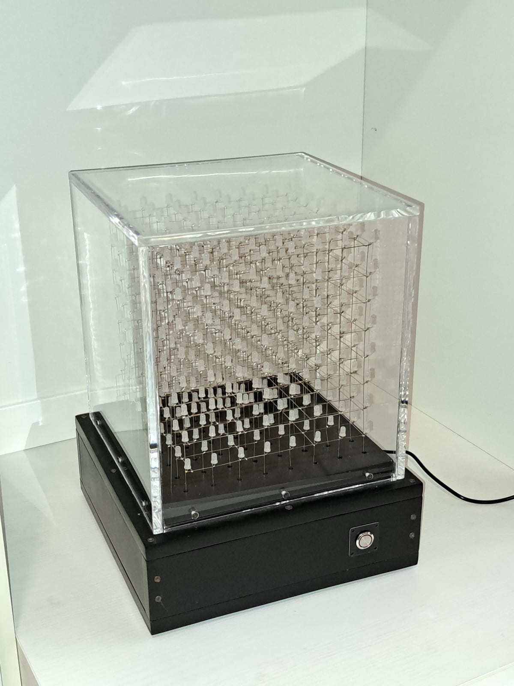
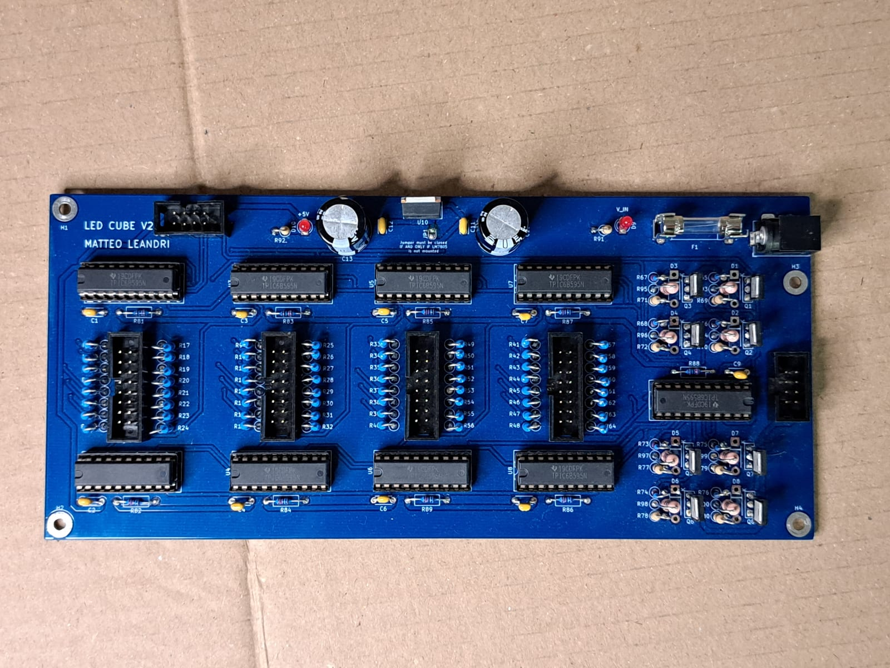
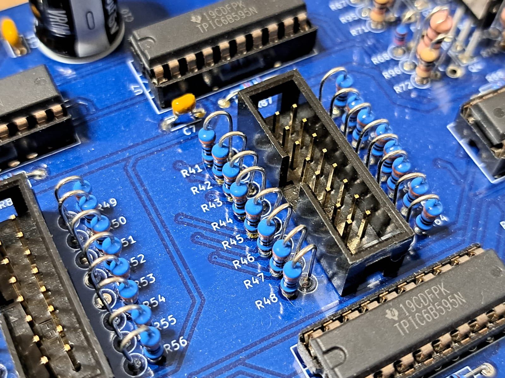
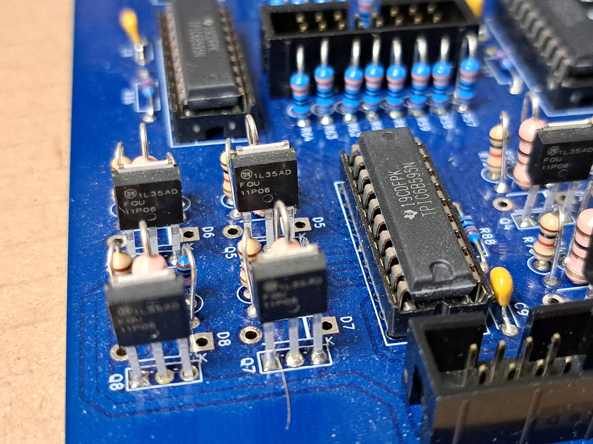
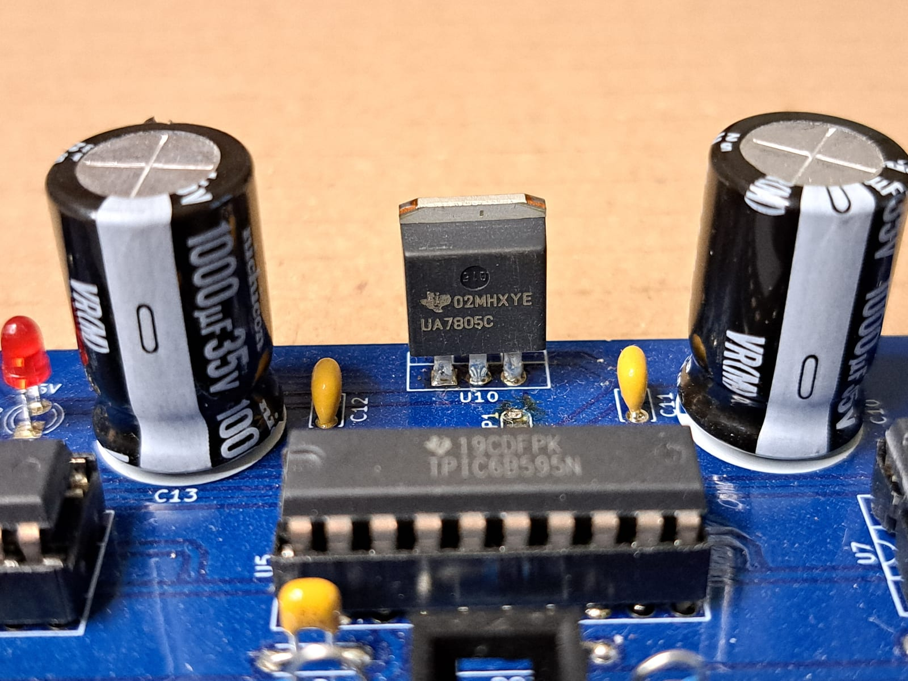
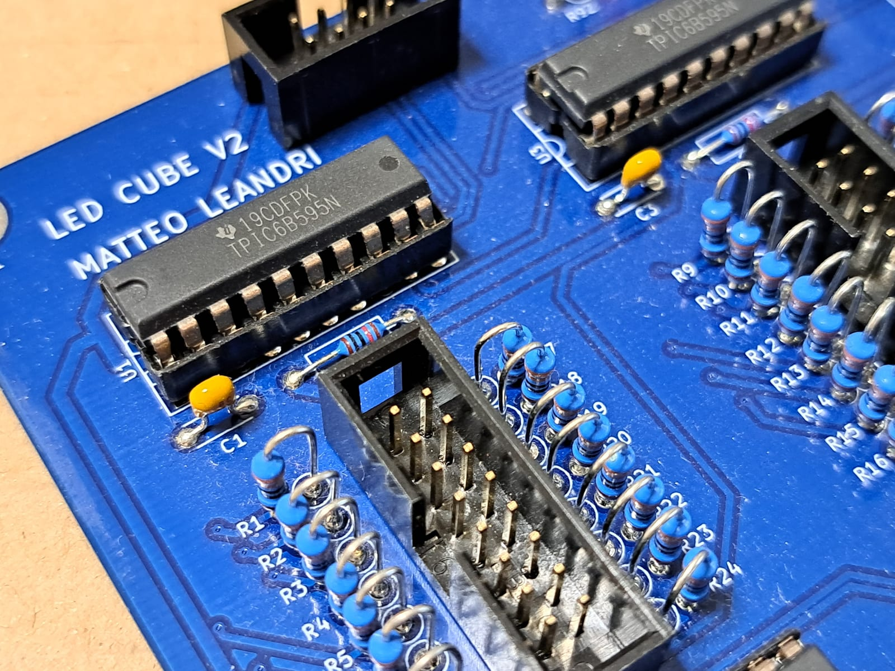
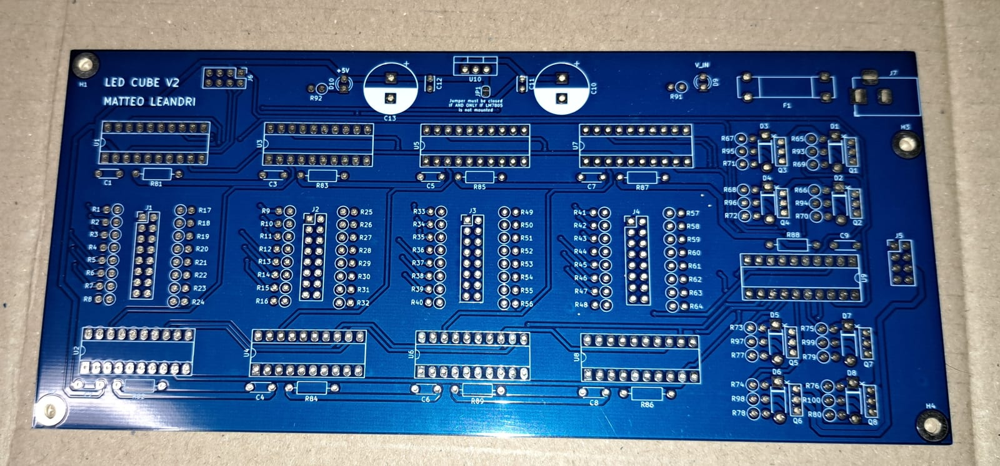
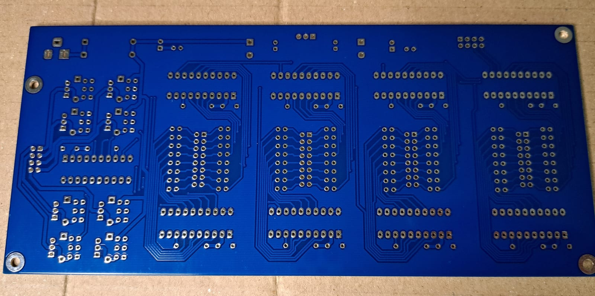
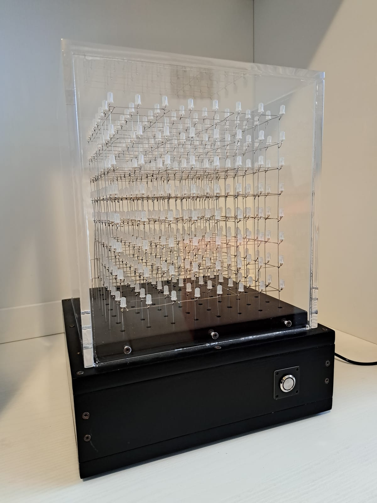

# LED Cube 8×8×8

A 3D matrix of 512 red LEDs (8×8×8) that plays animations, driven by an Arduino Uno through a custom driver board. I designed and built it as a personal project around 2022: the LED matrix, the driver PCB, the enclosure and the firmware.

<p align="center">
  
</p>

<!-- TODO: a GIF or short video of an animation would make the best first impression -->

## Overview

| | |
|---|---|
| LEDs | 512, red, arranged 8×8×8 (8 layers of 64) |
| Controller | Arduino Uno |
| Driver board | Custom two-layer PCB, "LED Cube V2" |
| Column drivers | TI TPIC6B595N power shift registers |
| Layer switches | FQU11P06 P-channel MOSFETs |
| Power | External DC input, fuse, µA7805 5 V regulator |
| Firmware | Built with PlatformIO |
| Year | ~2022 |

## How it works

The Arduino Uno does not have enough pins to drive 512 LEDs directly, so the cube is multiplexed: it is driven one layer at a time, fast enough that the eye sees a steady 3D image.

- **Columns:** each layer has 64 LEDs. Eight TPIC6B595N shift registers give 64 outputs, one per column, and the Arduino loads them over a serial interface with just a few pins.
- **Layers:** eight P-channel MOSFETs switch the eight layers, one at a time. A ninth TPIC6B595N (U9) drives the MOSFET gates, so the layers are selected through the same serial chain.
- **Current limiting:** 64 resistors, one per column (R1–R64).

<!-- TODO: complete:
     - refresh rate and how long each layer stays on
     - which Arduino pins are used (clock, data, latch, output enable?)
     Add a block diagram in docs/images/ if you have one. -->

## Hardware

### Driver board

I designed the driver board as a two-layer PCB with through-hole components. This is the second version: the first board was a prototype.

<p align="center">
  
</p>

- **U1–U8:** TPIC6B595N shift registers, one per group of 8 columns, in sockets.
- **J1–J4:** four box headers carry the 64 column lines to the cube (16 lines each).
- **U9:** TPIC6B595N that drives the gates of the layer MOSFETs.
- **Q1–Q8:** FQU11P06 P-channel MOSFETs for the eight layers.
- **Power section:** DC jack, fuse F1, µA7805 5 V regulator with 1000 µF bulk capacitors, and two indicator LEDs (V_IN and +5 V). A jumper (JP1) bypasses the regulator when it is not mounted.

| Column drivers and connectors | Layer MOSFETs |
|---|---|
|  |  |

| Power supply | Silkscreen |
|---|---|
|  |  |

### Bare PCB

| Top | Bottom |
|---|---|
|  |  |

<!-- TODO: add the schematic and PCB files (KiCad or PDF/PNG export) and the BOM to hardware/ -->

### Cube and enclosure

The LEDs sit in a black perforated base inside an acrylic cover, on a black wooden box that holds the electronics and a front push button:

- **short press:** switch to the next animation;
- **hold for 5 seconds:** turn the cube off, and a ring of light comes on in the button;
- **press again:** turn the cube back on.

<p align="center">
  
</p>

<!-- TODO: how the matrix was soldered (jig, wire) -->

## Firmware

The firmware is a [PlatformIO](https://platformio.org/) project in [`firmware/`](firmware/).

```bash
cd firmware
pio run                 # build
pio run -t upload       # flash the Arduino Uno over USB
```

<!-- TODO: list the animations and how they are stored or generated. -->

## Build notes

<!-- TODO: the problems you solved and what you learned. This is the section
     that shows the engineering reasoning, e.g.:
     - keeping 512 LEDs straight and evenly spaced while soldering
     - brightness and current per layer
     - flicker and refresh timing -->

## License

Firmware released under the [MIT License](LICENSE).
